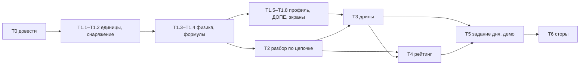

# Бэклог кода по решениям

Что нужно поменять в коде, чтобы он соответствовал решениям. У каждой задачи есть причина (номер решения) и слой. Порядок внутри слоя — по зависимостям. ✓ — сделано (ссылка на спеку в `code/README.md`). Остальное — план.

Слои — как в README проекта: `src/core` — чистый TS; `src/sim` — без DOM; `src/app` — экраны.

## core

| # | Задача | Причина |
| --- | --- | --- |
| C1 ✓ | `windClockShare` по синусу: 0 / 0,5 / 0,87 / 1, получасы по синусу | Б15, FORMULAS |
| C2 ✓ | Траектория и ДОПЕ до 1000 м (сейчас `MAX_TRAJECTORY_M = 700`) | В8, В9 |
| C3 ✓ | Модуль игровых формул `game-formulas.ts`: дальность по сетке, D′, доля по часам, W, K_атм, упреждение, итог, округление до клика | Б15, FORMULAS |
| C4 ✓ | Калибровка K_ветра для патронов А, Б, В и коэффициентов атмосферы по ядру; спека-тест «≤ 1 клик на 100–600 м» | Б15 |
| C5 ✓ | Карточка ДОПЕ: колонки ВЕРТ, клики, t полёта, ветер на 1 м/с; эталон +15 C / 1013 гПа | Б7, М1 |
| C6 ✓ | Оценка: 10 / 5 / 0, не больше 2 выстрелов на цель; классы 70 / 85 / 100 % + навыковые цели; множители режима | В4, FORMULAS |
| C7 ✓ | Проверка расчёта: статусы шагов в кликах, типы ошибок, эталон каждой строки (АВТО — итог блокнота игрока) | CHECK-RESULT, Б23–Б25 |
| C8 ✓ | Движущаяся цель: положение во времени, упреждение | М1 |
| C9 ✓ | Зоны ветра с весами для среднего ветра | FORMULAS, упр. 09, В29 |

## sim

| # | Задача | Причина |
| --- | --- | --- |
| S1 ✓ | Сессия позиции: накручено, цель барабана из блокнота, остаток «ещё N кл.», перекрут | Б3, Б4 |
| S2 ✓ | Точка сетки в момент выстрела (вызов) — для разбора | В12 |
| S3 ✓ | Анализ группы: вертикальная струна, горизонталь, низко-вправо, разброс → диагноз основ | В12 |
| S4 ✓ | Диагноз выстрела: «данные» или «выполнение» по вызову против попадания | В12 |
| S5 ✓ | Поправка на второй выстрел в кликах | В12 |
| S6 ✓ | Серия и магазин: 5 / 5, смена патрона между выстрелами, конец упражнения на 0 | Б31, Б33 |
| S7 ✓ | Холодный выстрел: первый выстрел серии со сдвигом | SNIPER-PROGRAMS, упр. 02 |
| S8 ✓ | Курс: 00 + 12 упражнений вместо 9 задач (`tasks.ts`): каталог, постановка, навыковые цели, итог, прогресс; `tasks.ts`, `core/score.ts` и викторины помечены, удаляются в A2 | В3, М1 |
| S11 ✓ | Каталог прицелов по SCOPES: MIL FFP 3–12× для курса с 06 (сейчас курс везде на «Ёлке», Dot — SFP с ходом 6 MIL) | В14, S8 |
| S9 ✓ | Блокнот: модель вкладок, шаги САМ (слоты, чипы, лента), АВТО (факторы вкл / выкл, вклад), «устарело» после смены патрона | Б2, Б5, Б17, Б22, Б33 |
| S10 ✓ | Модель подвижной мишени в сцене | М1 |

## app

| # | Задача | Причина |
| --- | --- | --- |
| A1 ✓ | Токены из `design/TOKENS.md` в `styles.scss`; убрать тему B | В23, В24 |
| A2 ✓ | Убрать нижние вкладки; главный экран-меню; курс-тропа на `sim/course`; удалить `sim/tasks.ts`, `core/score.ts`, `app/quiz` | В1, 08, S8 |
| A3.1 ✓ | Позиция, часть 1: каркас на новой логике (`FiringLine`, блокнот АВТО, барабаны на корпусе с метками и лупой, кольцо кратности), запуск упражнений 01–02 (спуск тапом, затвор сам), запись класса в прогресс | 01, Б3, Б4, Б12, В14, В31 |
| A3.2 ✓ | Позиция, часть 2: спуск с давлением и зона в стекле, Г-дорожка затвора, дыхание как навык — открывает 03 | 01, Б12 |
| A4 ✓ | Звук и вибрация по TOKENS: `Haptics.selectionChanged()` на клик, impact на упор | Б13 |
| A5.1 ✓ | Шторка блокнота и вкладки по брифу 02 (АВТО), «ВНЕСТИ НА БАРАБАНЫ», проверка в записи выстрела; удалена старая свободная игра — открывает 04, 05 | 02, Б3, В31 |
| A5.2 ✓ | Лист расчёта САМ по брифу 03, переключатель АВТО · САМ, «устарело» в САМ — открывает 06, 07, 08, 10 (класс 1 в 10 — после вызова в A6) | 03, Б17, Б33 |
| A6.1 ✓ | Разбор выстрела (05, блоки 1–4 и 7) и проверка (04); вызов игрока в 10; «в ДОПЕ»; «пересчитать и повторить» — перезапуск ×1.0 | В12, Б7, Б16, Б23–Б27 |
| A6.2 ✓ | Разбор: лепестки причин, траектории и группа (05, блоки 5–6) | В12, Б15 |
| A6.3 ✓ | Итог упражнения (07) и карточка брифинга (06) | В16, В17, В20 |
| A6.4 ✓ | Подсказки инструктора: рация и обучение (06), подсветка забытого фактора в 01–03 | И1, В16, Б22 |
| A6.5 ✓ | Обучающие подсказки для новинок 04–11 (станция и флажок, миллинг, лист САМ, смена патрона, зоны, карандаш, упреждение) на движке A6.4 | В16 |
| A7.1 ✓ | Свободная игра (09) | В9, Б33, В30 |
| A7.2 ✓ | Журнал (10), запись выстрелов свободной игры | Б7, Б8, В12 |
| A7.3 ✓ | Учебник (11): оглавление, карточки 47 терминов с формулой и примером из ядра, ссылки с итога | В21 |
| A7.3b ✓ | Учебник: b1 ссылки из подсказок, разбора и журнала; b2 схемы SVG в карточках; b3 «Попробовать на прицеле» | В21, Б3 |
| A7.4 ✓ | Настройки (12): громкость, щелчки барабанов, левша, чувствительность барабанов, спуск тапом, крупный текст, сброс с подтверждением, версия; удалены `--hub-*` и старые глобальные классы | В19 |
| A7.5 ✓ | Упр. 00 «Винтовка и прицел» (13): семь шагов без оценки, «ГОТОВ» открывает 01 | В3 |
| A8 ✓ | Стек слоёв для системной «назад»; подтверждение выхода; «прервано» | В15 |
| A9.1 ✓ | Сцена из фото: небо, вал, земля, гонг, отметины, ближняя трава; пределы наведения | В22, 14, 14a |
| A9.2 | Сцена: бумажная мишень 02 в SVG, перегенерированные R2b/R4, дальний план для 12, мираж шейдером | В22 |
| A9.3 ✓ | **a** флажки (09, 12, тап по флажку, веса зон, выбор режима 12); **b** дозор 11 (тележка, строка дозора, лепесток «Упреждение»). Было: Позиция: флажки по трассе в сцене (зоны ветра C9) — открывает 09 и 12; движущиеся цели на модели S10 — открывает 11; обучающие подсказки 09 и 11 на движке A6.4 | М1, В29, В16 |
| A10 ✓ | **a** каталог `src/i18n`, числа В7 из источников, `decimal`, удалён `playability`; **b** все экраны в каталоге, вне `src/i18n` русского текста нет. Было: тексты в i18n с параметрами, числа подсказок из расчёта | В7 |

## Тренажёр: план от 14.11 (В32–В42)

Поворот от игры к карманному тренажёру высокоточной стрельбы ([QUESTIONS](../QUESTIONS.md), В32–В42; [исследование спроса](../design/ognevoy-rubezh-demand-and-gaps.md)). Каждая задача — отдельный модуль по [порядку работы](README.md): спека → одобрение → юнит-тесты с мутацией → код → e2e → проверка в браузере → связанные e2e на сборке. Размер: S — день, M — 2–4 дня, L — неделя и больше. Стиль заморожен (В40): новые экраны собираются на текущих токенах.

**Статус 15.11:** T0.1 (`510bd16`), T0.2 (`24cdfc5`), T0.4 — 11 и 12 пройдены; по находкам T0.4a (`4c03e06`), T0.4b = В43 «упреждение без стороны» (`b0cca01`, спека sim-lead-unsigned), T0.4c (`9c805fe`). T1.1 «Единицы» — спека core-units: локаль форматов отложена в T6.3, переключатель — в T1.8. T1.2 «Снаряжение» — спека core-loadout: `CartridgeId` остаётся буквой до T1.5, прицел в снаряжение — тоже в T1.5. T1.3 «Физика» — спека core-physics: эталон lob (JBM закрыт), угломер и давление на станции — в T1.4; для T1.5 — BC профиля по ICAO или ASM (0,3 MIL на 1000 м). T1.4a «Формулы игрока» — спека core-player-formulas: угол с углом нуля Z, колонка деривации, Кориолис, имперские формулы; шаги проверки — в T1.4b; курс — В45. T1.4b «Шаги блокнота» — спека sim-notebook-geometry: угол, деривация, Кориолис, Этвёш; строка условий на позиции; местность в свободной игре; упражнения курса — отдельной спекой. Курс 13 «Горный склон» и 14 «Дальний рубеж» — спека sim-course-geometry (В45, В46): после зачёта, в звания не входят; глава учебника «Угол и вращение Земли» (8 терминов); вкладка-заглушка «Угол» убрана. T1.5 «Профиль винтовки» — спека sim-rifle-profile (В47): модель, проверка, Sg по Миллеру, 6 пресетов, хранение; `Cartridge.id` и `ScopeModel.id` — строки, каталоги курса узкие; ход барабанов профиля 30 / 10 MIL. T1.6a «ДОПЕ профиля» — спека core-profile-dope (В48): `sim/profile-dope.ts`, 50 м / 50 ярдов до 1000 м / 1100 ярдов, колонки в единицах прицела; печать и экспорт — T1.6b вместе с T1.7. T1.7 + T1.6b «Экран Винтовка» — спека app-rifle (В49), бриф 16: список, редактор, карточка, печать A6, картинка (Share / Filesystem), своя винтовка в свободной игре. Старый баг «итог с прицелом MOA в кликах по 0,1 MIL» исправлен: карточка позиции — с ценой клика прицела. T1.8 «Единицы на экранах» — спека app-units (В50): три части; T1.8a «показ» сделана — переключатель в настройках, позиция, станция, блокнот, брифинг, свободная игра, разбор, журнал, кучность своей винтовки; формулы расчёта — T1.8b, курс и тексты — T1.8c. T1.8b «расчёт САМ» сделана — спека sim-units-calc: карточка через 100 ярдов, колонки 10 °F / 0,3 inHg, K_imp, фишки и формулы листа в единицах игрока. T1.8c «курс и тексты» сделана — спека app-units-course (В51): дистанции курса по 25 / 50 ярдов, гонги 20″ / 28″ / 14″, ноль 100 ярдов, флажки 200 / 400 / 600 ярдов, тренер, вводное, учебник, «эталон условий»; ядро — дистанции точек до сантиметра. T1.8 закрыта. T2.1 «Цепочка подстановок» сделана — спека sim-miss-chain: 12 звеньев от дальности до накрутки, сумма = прежние «расчёт» + «ветер», упреждение — из лепестка исполнения. Открытый старт (В53, спека app-open-start): 01 без вводного, учебник и свободная игра открыты целиком. Встроенная винтовка «своя-custom» (В54, спека sim-builtin-rifle). T2.2 «Разбор и блокнот» сделана — спека app-review-chain (В52): одна лестница причин со звеньями и «было / надо», красный карандаш на шаге САМ и на вводе АВТО; итог и журнал — по прежним грубым категориям до T2.3. T2.3 «Журнал с величинами» сделана — спека app-journal-causes (В55): причины выстрела в MIL до 0,01 и цена клика, хранилище v2 (`or.progress.v2`, v1 остаётся копией), лента, «Ошибки» и итог — по звеньям. Оценки из спеки винтовки (В56) — исследование `docs/research/`, задача T1.9. Страница «О приложении» — спека app-about. T3.1 «Каталог дрилов» сделана — спека sim-drills (В57: все дрилы открыты): 6 счётных (карточка = лист САМ под один шаг, ответ — эталон листа) и 5 на позиции из `freePlayTask`, лестница целей `isLadder`. T3.2 «Экран счётных карточек» сделана — спека app-drill-cards (В59): `/drills` и `/drill/:id`, лист шага САМ на `NotebookEditor`, вердикт листом проверки, раунды в `drillRounds`. T3.3 «Дрилы на позиции и таймер» сделана — спека app-drill-timer (В60): метка дрила у задачи и этапный план, уровень «на время» с замком (2 раунда ≥ 80 %), 30 / 90 / 120 с, «время вышло» — промах без патрона, итог серии. T4.2 «Хранение и пересчёт» сделана — спека app-skill-storage: рейтинг в хранилище, учёт выстрелов серий, разовый пересчёт журнала (старые выстрелы — по грубой причине), на итоге рост навыков вместо звания; поправки T4.1: исполнение при попадании — 1, таймаут — только в раунде. T4.1 «Рейтинг по навыкам» сделана — спека sim-skill-rating: попытки из карточек, выстрелов (звенья T2.3 по навыкам) и раундов на время, Эло со шкалой 25 и шагом ≤ 4, старт 40, общий уровень с названиями по порогам. T0.3 не воспроизводится вне нагрузки полного набора. Вопросы прохождения — П18–П20.

Что уже есть в коде и на что опирается план:

- `js-ballistics` 3.1 умеет шаг нарезов, длину пули, угол места, завал, Кориолис и высоту, но `core/engine.ts` их не передаёт.
- Винтовка одна, глобальная (`RIFLE` в `core/content.ts`); патрон — `CartridgeId = 'A' | 'B' | 'C'`, тип используется в 22 файлах; кэш нуля в движке — по `CartridgeId`.
- `sim/miss-breakdown.ts` уже раскладывает промах на причины с точной суммой, но весь расчёт — одна причина `calc`, а ветер не делится на скорость и часы.
- Журнал (`JournalShot`) хранит главную причину и типы ошибок без величин.
- Capacitor в зависимостях, но платформы не созданы (нет `android/`, `ios/`, `capacitor.config`); service worker нет.

Первая проверка спроса возможна после T5 без T6: веб-демо на GitHub Pages, всё открыто.

### T0. Довести то, что есть

| # | Задача | Слой, файлы | Зависит | Причина | Готово, когда |
| --- | --- | --- | --- | --- | --- |
| T0.1 | Фишка температуры «17.7 C» → `decimal` | `app/notebook/calc-sheet.model.ts` (`chipText`) | — | A10c | юнит на «17,7 C» + мутация; S |
| T0.2 | Ловушка подсказки в 06: «Ветер записан. Теперь посчитай его сам» появляется только при выставленных часах и не перекрывает циферблат | движок подсказок A6.4 / A6.5, условие шага ветра | — | В16, прохождение 13.11 | e2e «скорость раньше часов → часы доступны, шаг записывается» + мутация; S |
| T0.3 | Два падения на mobile-webkit: итог «ПОВТОРИТЬ», разбор «в ДОПЕ» | `e2e/result.spec.ts:50`, `e2e/review.spec.ts:131` | — | прогон 13.11 | причина найдена (флак или баг); оба зелёные на сборке три раза подряд; S |
| T0.4 | Допройти 11 и 12 с нуля в браузере | — | T0.2 | «пройти от а до я» | 11 и 12 зачтены; найденное — задачами сюда; S |
| T0.5 | Пуш A10c (`8ff3e37`, `0c4ef94`) | git | — | A10 | с согласия автора |
| T0.6 | UX из прохождения: флажок 04 не виден на 8×, часы по флажку не читаются, поправка в 02 теряется при ошибке выполнения, станция завышает ветер | — | — | прохождение 13.11 | вопросы П12–П15 решены, задачи — сюда; S |

### T1. Ядро тренажёра: единицы, снаряжение, физика, профиль

| # | Задача | Слой, файлы | Зависит | Причина | Готово, когда |
| --- | --- | --- | --- | --- | --- |
| T1.1 | **Единицы.** `core/units.ts`: система `metric` / `imperial`; величины — дистанция (м / ярд), скорость (м/с / fps), ветер (м/с / mph), масса пули (г / гран), длина пули и высота прицела (мм, см / дюйм), температура (°C / °F), давление (гПа / inHg). Хранение всегда в СИ; `toDisplay`, `fromInput`, шаг округления на величину. Подписи — в каталоге; `i18n/format` получает формат по локали: запятая — правило русской локали, а не всего приложения (готовим английский). `Settings.unitSystem`, по умолчанию `metric`; переключатель в настройках | core, `i18n/format.ts`, `app/settings` | T0 | В38 | эталоны (1 ярд = 0,9144 м, 1 гран = 0,06479891 г, 1 inHg = 33,8639 гПа); обратимость ввод → СИ → показ; M |
| T1.2 | **Снаряжение вместо глобальной винтовки.** `Loadout = { rifle, cartridge, scope }` с ключом для кэша нуля. В `Rifle`: шаг и направление нарезов; калибр пули переезжает в `Cartridge` вместе с длиной пули и моделью сопротивления (G1 / G7). `BallisticsEngine.trajectory(loadout, conditions)`. `CartridgeId` → `string`; курс держит учебное снаряжение `COURSE_LOADOUTS` (А, Б, В с правдоподобными шагом и длиной). `RIFLE` → `@deprecated` + REMOVAL-CANDIDATES; его вызовы (8 файлов) — на снаряжение задачи | core, sim, app (22 файла с `CartridgeId`) | T1.1 | В34 | все текущие юнит- и e2e-тесты зелёные без изменения чисел курса (регрессия: ДОПЕ А, Б, В совпадает до 0,01 MIL); M |
| T1.3 | **Физика.** В условия сценария: угол места (°), высота над морем (м), широта и азимут стрельбы, флаг Кориолиса. В движок: `lookAngle`, шаг нарезов и длина пули (деривация), `altitude`, `coriolis`. Метеостанция показывает давление на станции (на высоте оно ниже), угол — новый прибор «угломер». `effectContributions(loadout, conditions, distance)` — вклад угла, деривации и Кориолиса (верт. и гор.) в MIL разностью прогонов «с эффектом / без», с кэшем. **Сверка:** `core/reference/*.json` — эталонные траектории JBM и Hornady 4DOF для 4 патронов (.308 175 гр, 6,5 Creedmoor 140 гр, .223 77 гр, .338 LM 300 гр) со входами, источником и датой | core, `core/scenario.ts` | T1.2 | В37 | расхождение с эталоном ≤ 0,1 MIL по вертикали и ≤ 0,05 MIL по ветру до 1000 м (иначе — причина в спеке); деривация на 1000 м в пределах ±20 % от JBM; L |
| T1.4 | **Игровые формулы и константы снаряжения.** Что игрок считает сам: горизонтальная дальность `D × cos угла`; деривация — из строки ДОПЕ; Кориолис `1000 × Ω × t × sin широты` (гор.) и вертикаль по азимуту. Имперские варианты: миллинг в ярдах (`размер″ × 27,78 / MIL`, `× 95,5 / MOA`), ветер в mph, упреждение. Константа ветра и коэффициенты атмосферы — не таблица на А, Б, В, а подбор по ядру для любого снаряжения. Новые шаги проверки расчёта `angle`, `spin`, `coriolis` в `core/calc-check.ts`; правка `logic/FORMULAS.md` | core, `logic/FORMULAS.md` | T1.3 | В37, В38, C4 | тест C4 «≤ 1 клик на 100–600 м» проходит для 4 эталонных патронов в обеих системах единиц; M |
| T1.5 | **Профиль винтовки.** `sim/rifle-profile.ts`: имя; винтовка (высота прицела, дистанция нуля, шаг и направление нарезов); патрон (скорость, разброс скорости, BC и G1 / G7, вес, калибр, длина пули); прицел (MIL / MOA, цена клика, FFP / SFP, кратность, тип сетки из каталога S11 — свои сетки, В42). Проверка диапазонов (скорость 300–1300 м/с, BC G7 0,1–0,5 / G1 0,2–1,0, ноль 25–300 м, высота прицела 2–10 см, шаг 6–16″, длина 10–60 мм); предупреждение о стабильности пули (Sg по Миллеру < 1,4). Пресеты — 6 распространённых патронов без торговых марок. Хранилище: `profiles`, `activeProfileId`; лимит бесплатной версии — флагом (включается в T6.2) | sim, `app/services/progress.store.ts` | T1.2 | В34, В41, В42 | граничные значения, Sg на эталонах, профиль переживает перезагрузку; M |
| T1.6 | **ДОПЕ профиля.** `buildDopeCard(engine, loadout, units)`: шаг 50 м / 50 ярдов до 1000 м (1100 ярдов); колонки ВЕРТ, клики, время полёта, ветер на 1 м/с (1 mph), **деривация**. Печать (стиль печати) и экспорт картинкой (canvas → PNG; на телефоне — Capacitor Share, в вебе — скачивание) | core, app | T1.4, T1.5 | В34 | ДОПЕ эталонного профиля совпадает с T1.3 до клика; картинка читается на листе A6 и на телефоне; M |
| T1.7 | **Экран «Винтовка».** `/rifle`: список профилей, редактор с вводом в выбранных единицах и сообщениями проверки, пресеты, предпросмотр ДОПЕ, «сделать активным» | app, новый бриф 16 | T1.5, T1.6 | В34 | e2e: пресет → правка → ДОПЕ → перезагрузка; касания ≥ 44; M |
| T1.8 | **Единицы на экранах.** Блокнот, станция, ДОПЕ, брифинг, разбор, журнал, учебник — через форматтеры T1.1. Сценарии дрилов и свободной игры берут круглые дистанции в выбранной системе; курс хранит метры и в имперской системе ставит ближайшие 25 ярдов (числа подсказок — из источников, В7) | app, `sim/course.ts`, `sim/free-play.ts` | T1.1, T1.4 | В38 | e2e 01 и 06 в имперской системе зачитываются; в каталоге нет единиц мимо форматтеров (расширить `catalog-guard`); L |
| T1.9 | **Оценки из спеки винтовки.** По исследованию (`docs/research/Огневой рубеж_ честная оценка…md`): длина ствола → скорость у дула по калибру (fps/дюйм из замеров с укорачиванием, рост ниже 16–18″); температура пороха — линейно по классу пороха, по двум замерам — `calcPowderSens`; Миллер с поправками скорости и плотности, Кортни–Миллер для полимерного наконечника; аэродинамический скачок Литца. Навеска → скорость — нет. McDRAG — позже, только запасной путь. Все оценки — `estimates` с «замени замером». До выпуска — решить вопрос LGPL-3.0 движка `bclibc` внутри `js-ballistics` | `sim/rifle-profile.ts`, ядро, редактор винтовки | T1.5 | В56 | юнит: пример Литца Sg 1,8 / t 1,6 с → 8,9″; .308 28″ → 16,5″ в пределах замеров; M |
| T1.10 | **Больше прицелов (TODO, состав уточнить с автором).** Сейчас в каталоге S11 пять: учебные «Ёлка» и Dot, MOA-сетка, «Ёлка», Dot. Добавить ещё, без торговых марок: сетки-«ёлки» с шагом 0,2 MIL и MOA, простую охотничью (дуплекс / BDC, SFP), сетку с мелкими делениями под упреждение; цена клика 0,05 MIL и ⅛ MOA; ход барабана и кратности разных классов. Каждая сетка — рисунок, деления для миллинга и проверка расчёта в своих единицах | `sim/scope-model.ts`, рисунки сеток, редактор винтовки | T1.5 | В42 (свои сетки) | миллинг и удержание на каждой сетке сходятся с ядром до клика; сетка выбирается в профиле; M |

### T2. Фишка: разбор промаха по цепочке

| # | Задача | Слой, файлы | Зависит | Причина | Готово, когда |
| --- | --- | --- | --- | --- | --- |
| T2.1 | **Цепочка подстановок.** Причина `calc` делится: в формулу по одному подставляются вводы игрока в постоянном порядке — дальность → строка ДОПЕ → условия → угол → деривация и Кориолис → скорость ветра → часы ветра → зоны → упреждение → округление → накрутка барабанов. Разность соседних звеньев — вклад шага в MIL; сумма лепестков по-прежнему равна попаданию (инвариант `missBreakdown`). У каждой причины — значение игрока и правда («скорость 4 вместо 5 м/с»). В АВТО шаги расчёта нулевые, остаётся накрутка | `sim/miss-breakdown.ts` → `sim/miss-chain.ts`; старое — `@deprecated` | T1.4 | В40 | сумма = попадание до 0,001 MIL на всех упражнениях курса; подмена одного шага даёт ненулевой вклад только своему звену; M |
| T2.2 | **Разбор и блокнот.** Разбор показывает лестницу причин: крупнейшая первой, MIL и клики, «было / надо». В листе САМ красный карандаш ставит дельту на шаг с ошибкой. Лепестки A6.2 остаются схемой | `app/review`, `app/notebook` | T2.1 | В40, В12 | e2e: ошибка скорости ветра в 06 → первая строка «ветер: скорость», дельта на шаге ветра; M |
| T2.3 | **Журнал с величинами.** `JournalShot.causes: { kind, mil }[]` (до 0,05); хранилище v2 с миграцией (у старых записей нет `causes`) | `app/journal`, `progress.store` | T2.1 | В39 | старый прогресс загружается без потерь (тест миграции на снимке v1); S |

### T3. Дрилы

| # | Задача | Слой, файлы | Зависит | Причина | Готово, когда |
| --- | --- | --- | --- | --- | --- |
| T3.1 | **Каталог дрилов.** `sim/drills.ts`: дрил = навык, тип (`count` / `position`), уровни (`learn` / `timed`), генератор по сиду, снаряжению и единицам. Счётные (6): миллинг, ДОПЕ с интерполяцией, ветер, условия, угол, упреждение. На позиции (5): холодный выстрел, ветер-вилка (3 цели, ветер меняется), лестница дистанций 200 → 700, дозор, этап на время (5 целей). Открытие: дрил доступен после упражнения курса, где учат его навык (ветер — 04 / 06, миллинг — 05, условия — 07, упреждение — 11); угол, деривацию и Кориолис учит уровень `learn` подсказками тренера; экзамен открывает всё (T3.6) | sim; генератор позиции — из `freePlayTask` | T1.5, T1.8 | В35, В36 | генераторы детерминированы по сиду; у каждой карточки эталон из ядра; M |
| T3.2 | **Экран счётных карточек.** 10 карточек в раунде: условия → ответ с клавиатуры блокнота; вердикт по правилам проверки расчёта (точно — ±1 клик, близко — ±2, иначе ошибка) красным карандашом, с ответом, формулой и ссылкой на термин учебника; итог раунда — точность, среднее время, ошибки по типам | `app/drill-cards`, `app/notebook/keypad` | T3.1 | В36 | e2e раунда миллинга; касания ≥ 44; M |
| T3.3 | **Дрилы на позиции и таймер.** Постановка дрила → позиция, как в свободной игре. Уровень `timed` открывается, когда в двух последних раундах `learn` ≥ 80 % «точно». Лимит: 30 с на карточку, 90 с на выстрел, 120 с на этап из 5 целей; время вышло — промах с причиной «время». Отсчёт виден | sim, `app/position` | T3.1, T2.1 | В36 | e2e: время вышло → промах «время»; переход на `timed` по правилу; M |
| T3.4 | **Совет тренера.** Приоритет навыка = (1 − рейтинг / 100) + min(дней без повтора / 7; 1); советуется верхний, с причиной («3 ошибки СТОРОНА за неделю»). Инструктор → тренер в каталоге | `sim/coach.ts`, `i18n/ru/instructor.ts` | T3.1, T4.1 | В36, В33 | юнит на порядок советов; S |
| T3.5 | **Экран «Дрилы».** Совет тренера сверху; список по навыкам с уровнем и замком; «Свой дрил» (бывшая свободная игра, адрес `/free` остаётся). Главный экран: Курс, Дрилы, Задание дня, Винтовка, Прогресс, Учебник + настройки | `app/drills`, `app/home`, бриф 08 (обновить) | T3.1–T3.4 | В35 | e2e навигации; S |
| T3.6 | **Экзамен вместо курса.** Для знающего: 12 в САМ лёгком доступно сразу как «экзамен»; ≥ 85 % — упражнения 01–11 отмечены «зачтено экзаменом» (без класса), дрилы открыты | `sim/course.ts`, `app/course` | T3.1 | В35 | e2e: экзамен сдан → 11 открыто, дрил ветра открыт; S |

### T4. Прогресс

| # | Задача | Слой, файлы | Зависит | Причина | Готово, когда |
| --- | --- | --- | --- | --- | --- |
| T4.1 | **Рейтинг по навыкам.** Навыки: дальность, ДОПЕ, ветер, условия, угол, упреждение, исполнение, скорость. Попытка = карточка или выстрел; исход 1 / 0,5 / 0 (точно / близко / ошибка) по звеньям цепочки T2.1 (звено больше 1 клика — ошибка навыка); сложность попытки 0–100 из уровня, дистанции, силы ветра и таймера. Обновление в духе Эло: `E = 1 / (1 + 10^((сложность − рейтинг) / 25))`, `рейтинг += 4 × (исход − E)`. Рейтинг не тает со временем — давность влияет только на совет тренера. Общий уровень — среднее навыков, названия по порогам (спортивные, без званий) | `sim/skill-rating.ts` | T2.1, T3.1 | В39 | юнит: серия точных растит, ошибки снижают, шаг изменения ограничен; S |
| T4.2 | **Хранение и пересчёт.** `skills` в хранилище; при обновлении прошлые выстрелы журнала один раз прогоняются в рейтинг. Звания курса (`rankFor`) → `@deprecated`; на итоге — рост навыков | `progress.store`, `sim/course.ts`, `app/result` | T4.1, T2.3 | В39 | миграция на снимке реального прогресса (`backup.or.progress.v1`); S |
| T4.3 | **Экран «Прогресс».** Рейтинги навыков, общий уровень, график по неделям, ошибки по типам; вход в журнал | `app/progress`, бриф 17 | T4.2 | В39 | e2e; M |
| T4.4 | **Спортивная лексика.** Каталог: курс «Снайперская подготовка», «аттестация», звания, «курсант», «инструктор» → спортивные слова (П16); проверка учебника | `src/i18n/ru/*` | П16 | В33 | `catalog-guard` + список замен в спеке; S |

### T5. Задание дня и проверка спроса

| # | Задача | Слой, файлы | Зависит | Причина | Готово, когда |
| --- | --- | --- | --- | --- | --- |
| T5.1 | **Задание дня.** Сид из даты по UTC — одно на всех; учебное снаряжение (честное сравнение); чередование «3 цели на позиции» / «10 карточек»; в зачёт идёт первая попытка, повторы без зачёта; серия дней; карточка результата текстом для отправки («Огневой рубеж · 14.11 · 2 из 3 · ветер 0,2 MIL») | `sim/daily.ts`, `app/daily` | T3.2, T3.3 | В35 | одинаковое задание на двух устройствах в одну дату; e2e; M |
| T5.2 | **Анонимные события.** Согласие при первом запуске, переключатель в настройках, по умолчанию выключено. Случайный id установки без личных данных. События: открытие (день), конец упражнения (id, класс), 1-й и 5-й выстрел, конец раунда дрила, задание дня, уход с экрана посреди серии. Транспорт — по П17 | `app/services/telemetry` | T3.5, П17 | В39 | без согласия запросов нет (e2e с перехватом сети); M |
| T5.3 | **Экран «Модель».** Учтённые эффекты; допущения (G7 / G1, атмосфера, ветер без вертикали); игровые формулы рядом с ядром; таблица сверки из T1.3 | `app/model`, учебник | T1.3, T1.4 | В37 | e2e; числа таблицы — из `core/reference`; S |
| T5.4 | **Офлайн-демо.** Service worker Angular для веба (GitHub Pages); в демо открыто всё | `angular.json`, `app.config.ts` | — | В41 | демо открывается без сети после первого визита; S |
| T5.5 | **Текст сверки** для Хабра из данных T1.3 | `docs/research/MODEL-VALIDATION.md` | T1.3 | В37 | публикует автор; S |

### T6. Перед сторами

| # | Задача | Слой, файлы | Зависит | Причина | Готово, когда |
| --- | --- | --- | --- | --- | --- |
| T6.1 | **Capacitor.** Платформы Android и iOS, id приложения, иконки, заставка; проверка на настоящих телефонах: вибрация, звук, сохранение; замер кадров сцены на слабом Android | корень проекта | T5 | В38 | сборки ставятся на два устройства; ≥ 50 кадров/с на слабом; M |
| T6.2 | **Pro.** Флаг и карта доступа: больше одного профиля, печать и экспорт ДОПЕ, уровни `timed` и этапы, Кориолис. Покупка в сторе и восстановление покупки; в веб-демо всё открыто флагом сборки. Плагин покупок — в спеке | `app/services/pro`; T1.5, T1.6, T3.3 | T6.1 | В41 | e2e бесплатной версии: второй профиль → предложение Pro; M |
| T6.3 | **Английский.** `src/i18n/en` по типу `Messages`, выбор языка, локаль форматов (в английском точка), английское название | `src/i18n` | T1.1 | В38, В40 | `catalog-guard` для обоих языков; e2e 01 на английском; L |
| T6.4 | **Страница магазина.** Возрастной рейтинг; правила сторов об оружейной тематике (спортивный тренажёр, без продажи оружия); ярлыки приватности под T5.2; первый кадр — разбор промаха | docs | T6.1–T6.3 | В33, В40, В41 | S |
| T6.5 | **Стиль по ресерчу автора.** Замена токенов (как A1), брифы новых экранов, мираж и дальний план (A9.2) | `src/theme`, `design/` | ресерч | В40 | `tokens.spec` зелёный; L |

## Тесты

Для каждой задачи — юнит-тесты рядом с файлом и e2e на экран. Каждый новый тест проверяется мутацией (правило 22 CLAUDE.md). Мутации не запускать вместе с e2e.
