сдфг# Огневой рубеж — как приложение выглядит сейчас

Состояние на 1 ноября 2026, сборка этапа 1 («каркас»). Документ для дизайнера: что уже собрано по дизайн-системе [«Хаб расчёта»](https://claude.ai/artifact/3bVMwcYNSDQEVPVER1VbEE), где мы отошли от превью, что сделано без макета и какие макеты нужны. Скриншоты — в `docs/design/screens/`, сняты в портрете 390×844 pt (×2), тема A, если не указано иное.

**Коротко.** Готовы 11 экранов и 3 состояния экрана прицела. Цвета, шрифты, размеры касаний и типографика взяты из `tokens.json` и превью. Сцена в прицеле временная (Canvas 2D, не финальный арт). Без макетов сделаны: площадка спуска и панель затвора внутри прицела, журнал, викторина, настройки, раскрытый список задач. Ниже по каждому экрану — что на нём, как ведёт себя и вопросы к дизайну.

## Содержание

1. [Как посмотреть](#как-посмотреть)
2. [Карта навигации](#карта-навигации)
3. [Общий стиль](#общий-стиль)
4. [Экраны](#экраны)
5. [Звук и вибрация](#звук-и-вибрация)
6. [Известные визуальные дефекты](#известные-визуальные-дефекты)
7. [Что нужно от дизайна](#что-нужно-от-дизайна)

## Как посмотреть

```
cd ognevoy-rubezh
npm start            # http://localhost:4200
```

На широком экране приложение показывается колонкой 430 pt по центру (телефонная рамка). Для точного вида откройте DevTools → режим устройства → 390×844.

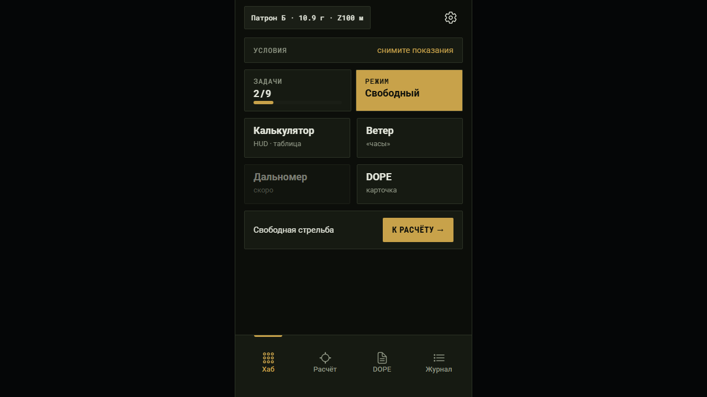

## Карта навигации

Четыре вкладки внизу, как в макете: **Хаб · Расчёт · DOPE · Журнал**. Экраны внутри вкладки открываются поверх с сохранением панели вкладок. Без панели — только прицел (на весь экран).

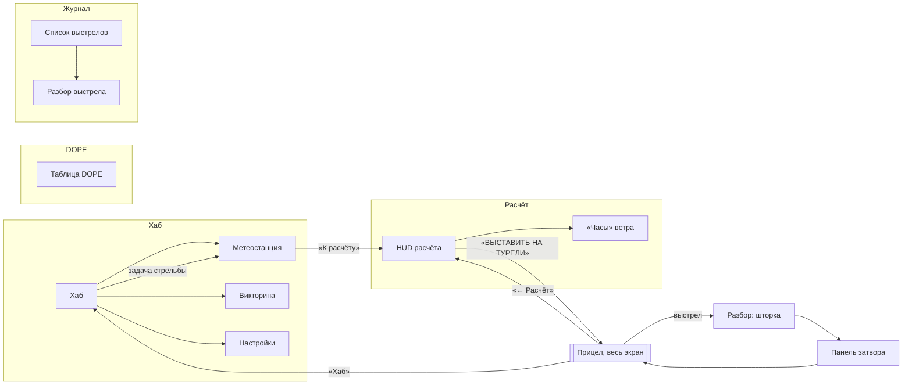

Основной путь игрока (ритуал из спеки): **Хаб → задача → Метеостанция (снять показания) → HUD (расчёт) → Прицел (накрутка, спуск) → Разбор → затвор → следующий выстрел → итог задачи (звёзды)**.

| Экран | Адрес | Вкладка | Макет в дизайн-системе |
| --- | --- | --- | --- |
| Хаб | `/tabs/hub` | Хаб | HubA/BHomeWeather, экран 1 |
| Метеостанция | `/tabs/hub/weather` | Хаб | HubA/BHomeWeather, экран 2 |
| Викторина | `/tabs/hub/tasks/:id` | Хаб | нет |
| Настройки | `/tabs/hub/settings` | Хаб | нет |
| HUD расчёта | `/tabs/calc` | Расчёт | HubA/BHud |
| «Часы» ветра | `/tabs/calc/wind` | Расчёт | HubA/BDopeWind, экран 2 |
| DOPE | `/tabs/dope` | DOPE | HubA/BDopeWind, экран 1 |
| Журнал | `/tabs/log` | Журнал | нет |
| Разбор (из журнала) | `/tabs/log/:id` | Журнал | HubA/BScopeDebrief, экран 2 |
| Прицел | `/scope` | без вкладок | ScopeSim + HubA/BScopeDebrief экран 1 + HeartbeatTrigger + BoltReload |

## Общий стиль

### Темы и цвета

Две темы, переключаются в настройках: **A «Полевой HUD»** (по умолчанию) и **B «Дневное снаряжение»**. Значения — один в один из `tokens.json`.

| Токен | A | B | Где используется |
| --- | --- | --- | --- |
| `hub-bg` | #0E1012 | #D9D3C3 | фон экранов |
| `hub-surface` | #1A1D21 | #EFEADB | карточки, панель вкладок, полоса прицела |
| `hub-surface-2` | #24282D | #E3DCC9 | сегменты, поля ввода, активная строка списка |
| `hub-text` | #E6E8EA | #1F1D18 | основной текст |
| `hub-text-2` | #9AA1A9 | #58544A | метки, подписи, неактивные вкладки |
| `hub-accent` | #F2B233 | #7F4A00 | главные кнопки, выбранные чипы, ключевые числа, активная вкладка |
| `hub-on-accent` | #1B1405 | #FFFFFF | текст на акценте |
| `hub-ok` | #4CC38A | #1B6A40 | попадание, «в круге», пройденные шаги затвора |
| `hub-error` | #EE5A5E | #B3261E | промах, «вне круга», значок упора |
| `hub-warn` | #F5A524 | #7F5400 | предупреждения, удержание не выбрано |
| `hub-line` | #30353B | #BDB5A0 | рамки и разделители |
| `hub-metal-light/-dark` | #4A4E55 / #0B0C0E | #ECEEF0 / #8B8E95 | корпус прицела, барабаны, крыльчатка |

Цвета приборов заданы только в превью и взяты оттуда: ЖК метеостанции (A: #0A0B0C с цифрами #FFB734; B: #C3CAB0 с #1D2417), корпус станции (A #1C1E21, B #E7A21A), панель «Поправка» на HUD (#0A0B0C, цифры #FFC14A со свечением — в обеих темах), циферблат часов (A #14171A со стрелкой #E5484D; B #EFE8D4 со стрелкой #B3261E), индекс барабана (A #F2B233, B #B3261E). **Просьба:** вынести их в токены.

### Шрифты

- **Roboto** — интерфейс; **Roboto Mono** с табличными цифрами — все числа; **Caveat** — пока нигде (по превью нужен для карандашных правок в DOPE темы B, не сделано).
- Размеры: HUD-числа 64 pt (поправка) и 52 pt (дистанция); вторичный текст 17–20; таблицы 16; метки 13 pt капсом с разрядкой 0,07 em. Минимум — 13 pt: все подписи 10–12 px из превью подняты до 13.

### Компоненты

| Компонент | Как сделан сейчас |
| --- | --- |
| Карточка | фон `hub-surface`, рамка 1 px `hub-line`, радиус **16** (в `tokens.json` записано 12 — оставили как в превью), тень по теме |
| Кнопка | высота ≥ 48, радиус 14, 15/20 жирный, вертикальный градиент; главная — градиент A #F7C451→#E09D14, B #A05C00→#7A4600; крупная (HUD, метеостанция) — 72 pt, радиус 18 |
| Чип | высота ≥ 44 (в превью 32 — подняли до минимальной зоны касания), радиус 999, выбранный — заливка акцентом |
| Сегмент | 52 pt, радиус 14, разделители 1 px, выбранная ячейка — акцент (ветер, дистанция на HUD) |
| Метка | 13/16, капс, `hub-text-2` |
| Панель вкладок | фон `hub-surface`, рамка сверху; иконки Ionicons (не из макета), подпись 13; активная — акцент + полоска 3 pt над иконкой |

Иконки вкладок — стандартные Ionicons (сетка, прицел, документ, список), близкие к превью, но не те же. **Нужны финальные иконки.**

## Экраны

### 1. Хаб

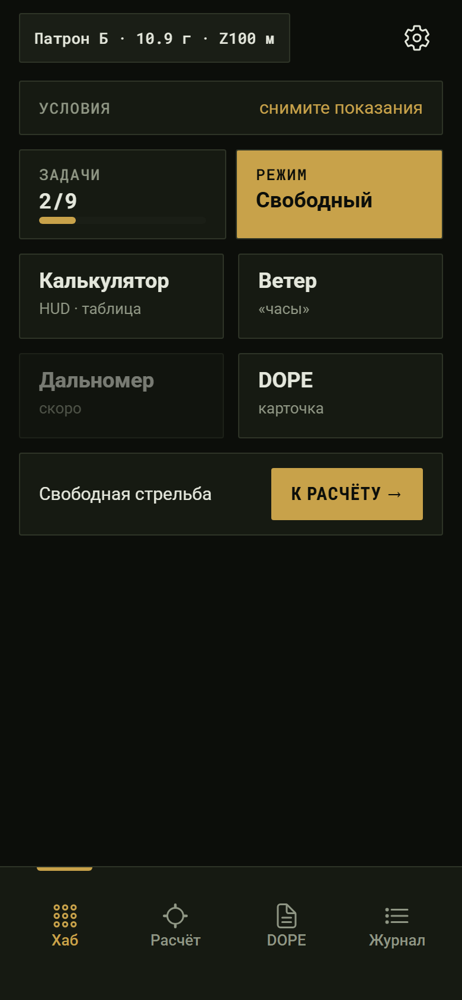 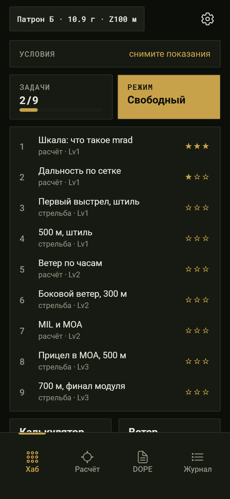

Сверху вниз:

- **Чип патрона** `Патрон Б · 10.9 г · Z100 м` (в превью `6.5 CM · 140gr` — заменено на вымышленные патроны) и **шестерёнка** → настройки.
- **«Условия»** — карточка-ссылка на метеостанцию. До замера: «снимите показания» (предупреждение). После: зелёная точка «свежие · ЧЧ:ММ» и четыре столбца: Темп., Давл., DA, Ветер (скорость + часы). На Lv1–2 давление и DA — «— стд.».
- **«Задачи N/9»** с полосой прогресса — нажатие раскрывает список прямо на хабе (решение 31.10: без отдельного экрана). **«Режим Свободный»** — залит акцентом, когда активен; нажатие запускает свободную стрельбу.
- **Список задач** (раскрывается): номер, название, «расчёт/стрельба · LvN», звёзды ★☆☆. Закрытые задачи — 40 % прозрачности. Активная задача — подложка `hub-surface-2`.
- **Плитки**: Калькулятор (→ HUD), Ветер (→ часы), Дальномер (неактивна, «скоро»), DOPE.
- **Строка текущей задачи** с кнопкой «К расчёту →».
- **«Последний выстрел»** (появляется после первого выстрела) → разбор.

Отличия от превью: нет «Режима» как переключателя Мастерская/Поле (в первом релизе только «Мастерская»); список задач — наш, без макета.

### 2. Метеостанция

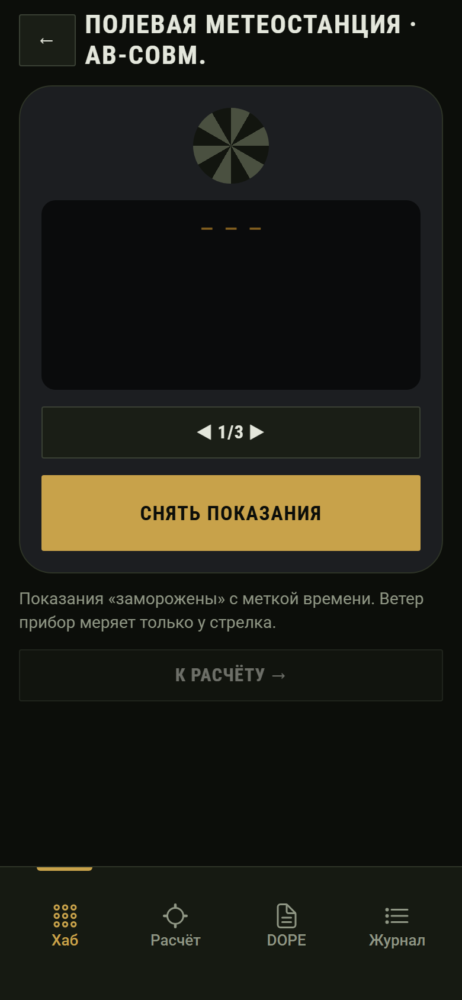 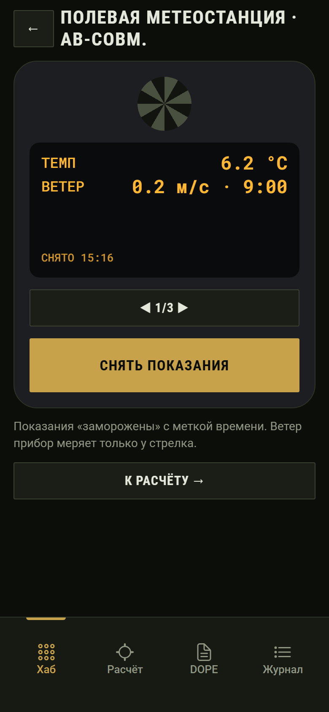 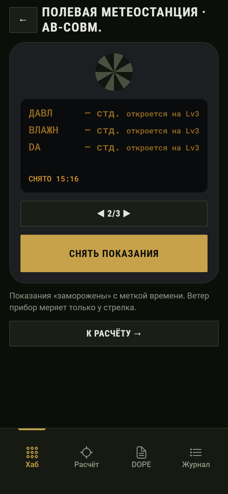 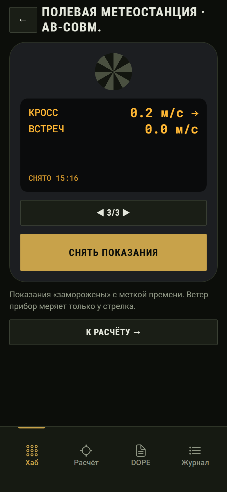

- Заголовок «Полевая метеостанция · AB-совм.», кнопка ← (к расчёту).
- Корпус станции с крыльчаткой (упрощённая заглушка — конический градиент), ЖК со строками, одна кнопка `◀ 1/3 ▶` листает страницы, крупная **«СНЯТЬ ПОКАЗАНИЯ»**.
- Страницы: 1 — ТЕМП, ВЕТЕР (скорость · часы); 2 — ДАВЛ, ВЛАЖН, DA; 3 — КРОСС (со стрелкой ←/→), ВСТРЕЧ.
- После замера показания **заморожены**: «СНЯТО ЧЧ:ММ». Повторный замер даёт новые значения (ветер меняется во времени).
- **Lv1–2:** строки страницы 2 серые: «— стд. откроется на Lv3». Вид закрытой строки в превью не нарисован — сделали полупрозрачной.
- Ниже подсказка и «К расчёту →» (неактивна до замера).

Не сделано по превью: переключатель день/ночь ☀/☾, точная форма корпуса и крыльчатки.

### 3. HUD расчёта

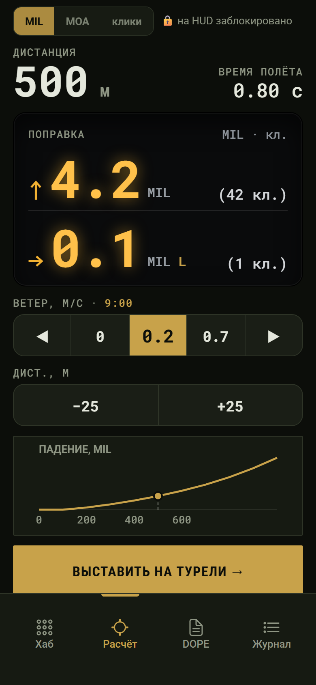

- Сегмент `MIL | MOA | клики` с замком «на HUD заблокировано» (подсвечена единица текущего прицела).
- **Дистанция** 52 pt и **время полёта** справа.
- **Панель «Поправка»** (тёмная ЖК в обеих темах): `↑ 4.2 MIL (42 кл.)` и `→ 0.1 MIL L (1 кл.)`, числа 64 pt со свечением.
- Предупреждения-чипы: «⚠ трансзвук на этой дистанции», «⚠ нет показаний метеостанции» (ссылка на станцию).
- **Ветер, м/с · 9:00** — сегмент `◀ v−0.5 v v+0.5 ▶`; ссылка с часами ведёт на «часы» ветра.
- **Дист., м** — `−25 / +25` (100–700 м).
- **График «ПАДЕНИЕ, MIL»** 0–700 м с точкой текущей дистанции.
- **«ВЫСТАВИТЬ НА ТУРЕЛИ →»** 72 pt → прицел.

Отличия: ось графика 0–700 (в превью 0–1200); зона трансзвука на графике не закрашена; на Lv1–2 расчёт берёт стандартное давление 1013.

### 4. «Часы» ветра

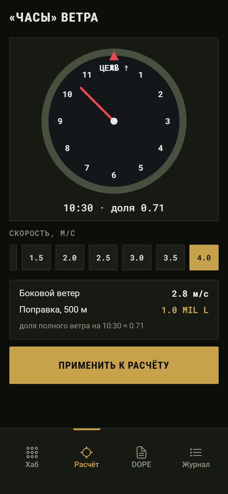

- Циферблат 1–12 с красным треугольником и «ЦЕЛЬ ↑» на 12, красная стрелка направления. Касание по ободу ставит направление с шагом 30 мин (15°).
- Под циферблатом: `10:30 · доля 0.5`.
- **Скорость** — горизонтальная лента чипов 0–12 м/с шагом 0,5 (в превью колесо 2,5–5,5).
- Карточка результата: «Боковой ветер 2.0 м/с», «Поправка, 500 м: 0.7 MIL L», «доля полного ветра на 10:30 ≈ 0.5 · шаг 15°».
- **«ПРИМЕНИТЬ К РАСЧЁТУ»** → обратно на HUD.

Правило долей: ±15° от 3/9 часов — 1; ±15° от 12/6 — 0; остальное — ½.

### 5. Прицел (весь экран)

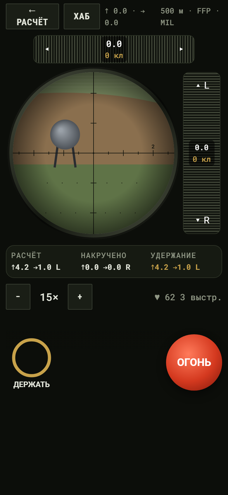 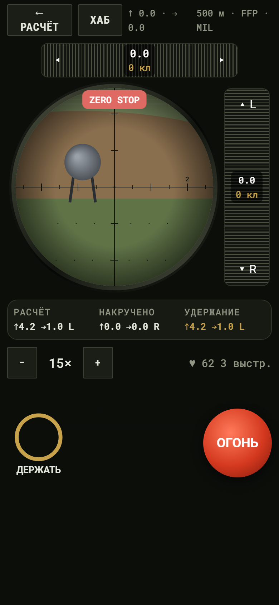

- **Верх:** кнопки «← Расчёт» и «Хаб»; моно-строка накрученного `↑ 0.0 · → 0.0`; справа `500 м · FFP · MIL` (для Dot ещё «верно на 12×»).
- **Верхний барабан (высота):** полоса 276×48 с насечкой, значение и клики в центре, `◂ ▸` по краям по 1 клику. Перетаскивание вбок — 1 клик на 9 pt.
- **Стекло:** круг R 138 pt в металлическом кольце. Внутри — **временная сцена**: небо, поле, вал, стальная пластина на ножках, полосы марева, сетка выбранного прицела, виньетка. С Lv3 — флажки на 200/400/600 м. Перетаскивание картинки — наведение. Картинка «живая»: пульс, дыхание, дрейф, отдача.
- **Правый барабан (ветер):** вертикальная полоса 64×276, `▴ L` / `▾ R`.
- **Значки упора:** ZERO STOP / УПОР ВВЕРХ / УПОР — красная плашка над стеклом с дрожанием 140 мс.
- **Полоса «РАСЧЁТ / НАКРУЧЕНО / УДЕРЖАНИЕ»:** удержание зелёное, когда остаток меньше полуклика, иначе янтарное.
- **Свободный режим:** чипы прицелов (Ёлка, MOA, Dot, Fine), дистанций (300/500/700) и «Сброс».
- **Кратность** `− 15× +`, пульс ♥, остаток выстрелов.
- **Липкая нижняя панель:** кольцо **«ДЕРЖАТЬ»** (задержка дыхания: держать пальцем; кольцо убывает за 8 с; «ДЕРЖУ» → «ВЫДОХ») и красная круглая **«ОГОНЬ»** 96 pt.

Отличия от ScopeSim: сцена, затмение (серп) и размытие края — заглушки до этапа 3; барабаны — полосы с насечкой, без шкалы с цифрами и золотого индекса; нет индикатора крена CANT и полосы DOPE из трёх строк (есть в HubAScopeDebrief).

#### 5а. Спуск (решение 31.10: на каждом выстреле)

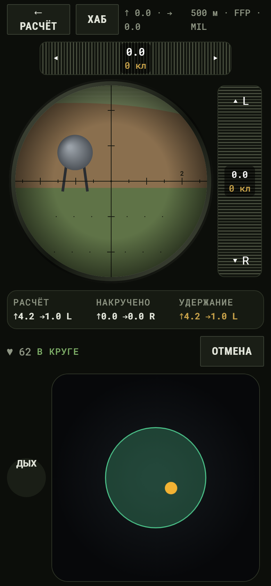

«ОГОНЬ» превращает нижнюю панель в **площадку спуска** (по HeartbeatTrigger): пульс ♥, статус «В КРУГЕ / ВНЕ КРУГА», «Отмена», маленькая кнопка «ДЫХ» слева (второй палец), площадка с зелёным кругом (радиус от пульса: 62 → 73 pt, 118 → 38 pt) и янтарным маркером, полоса «Нажатие на спуск N %». На 100 % — выстрел.

Без макета: как площадка встраивается в прицел, где «ДЫХ», нет ЭКГ-ленты, крупного пульса и чипов пульса из превью. **Нужен макет.**

#### 5б. Разбор (шторка)

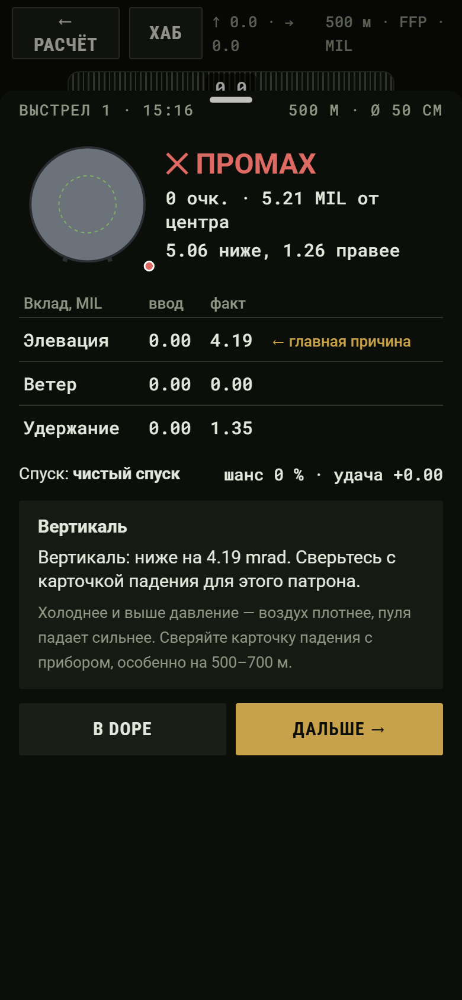

Выезжает снизу на 92 % высоты после выстрела. «выстрел N · время», «дистанция · Ø пластины», мишень с точкой и пунктиром центральной зоны, **✓ ПОПАДАНИЕ / ✕ ПРОМАХ**, очки и отклонение, таблица «Вклад, MIL — ввод / факт» (Элевация, Ветер, Удержание) с «← главная причина», строка «Спуск: чистый / средний / рывок · шанс N % · удача ±X», карточка-правило (заголовок, вывод, правило), кнопки **«В DOPE»** и **«Дальше →»**.

Отличия: нет мини-графиков «СБОКУ / СВЕРХУ» и столбиков в таблице; нет строки «Спин-дрейф» (появится с Lv3); «шанс» и «удача» — наше дополнение.

#### 5в. Затвор (решение 31.10: панель в прицеле)

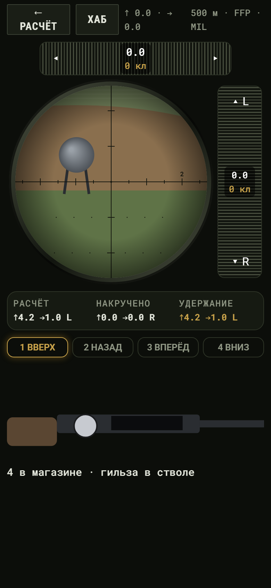

Шкала шагов «1 ВВЕРХ · 2 НАЗАД · 3 ВПЕРЁД · 4 ВНИЗ» (текущий — янтарная рамка со свечением, пройденные — зелёные), винтовка сбоку (SVG-заглушка: ложа, коробка, окно, ствол), шарик рукояти — тянуть пальцем по шагам. Подпись «N в магазине · патрон в стволе / гильза в стволе / ствол пуст», время цикла, «Новый магазин» при пустом магазине. После запирания — снова «ОГОНЬ».

Без макета: встраивание в прицел. Заглушка вместо винтовки из BoltReload: нет вылета гильзы, патрона в окне.

#### 5г. Итог задачи

После последнего выстрела задачи нижняя панель показывает звёзды ★★☆, очки N/M, «Задача пройдена / Нужно ещё раз», «К задачам» и «Ещё раз». Без макета.

### 6. DOPE

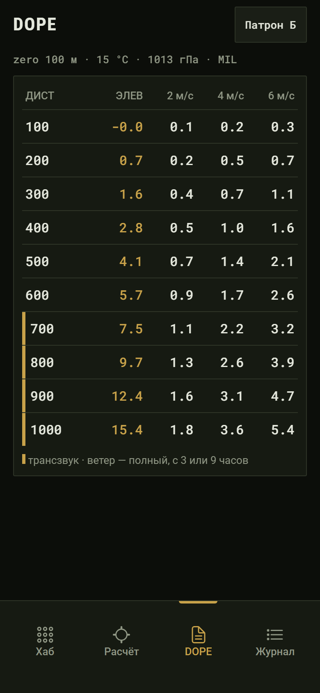

Заголовок, чип патрона, строка условий `zero 100 м · 15 °C · 1013 гПа · MIL`. Таблица: ДИСТ 100–700, ЭЛЕВ (акцентом), ветер 2 | 4 | 6 м/с (полный, с 3 или 9 часов). Строки с трансзвуком отмечены янтарной полосой слева; легенда внизу.

Отличия: нет ✓ подтверждённых строк, «ручной правки», «Колонок ветра», экспорта «напульсник»; тема B не бумажная (лист с карандашом Caveat из превью не сделан).

### 7. Журнал и разбор из журнала

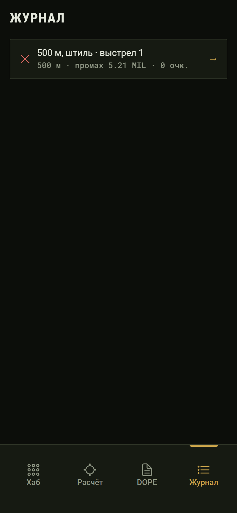 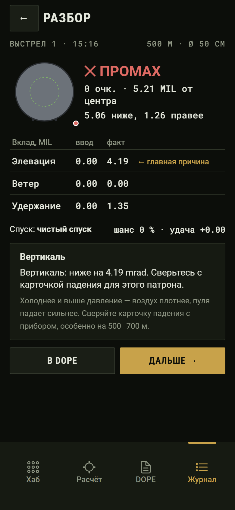

Карточки выстрелов: ✓/✕, «задача · выстрел N», «дистанция · попадание / промах X MIL · N очк.», → разбор. Разбор — тот же блок, что в шторке, с кнопкой ←. **Экрана журнала в дизайне нет.**

### 8. Викторина

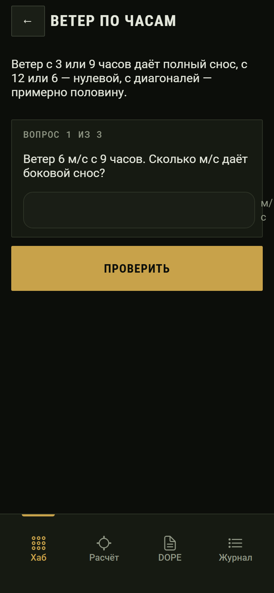 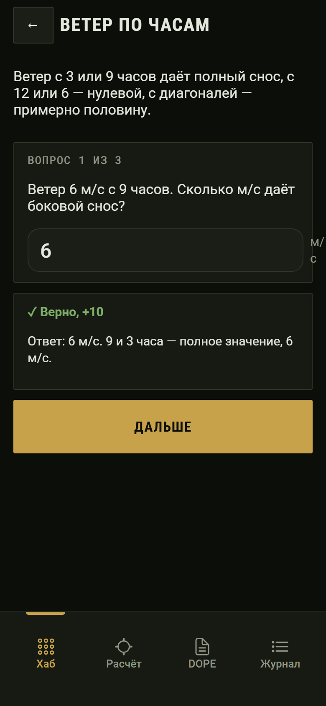

← к задачам, название, описание, карточка «Вопрос N из M» с полем ввода (крупный моно-шрифт, десятичная клавиатура) и единицей, «ПРОВЕРИТЬ». После ответа — «✓ Верно, +10» / «✕ Не совпало» с объяснением и «ДАЛЬШЕ / ЗАВЕРШИТЬ». Итог — звёзды, очки, «К ЗАДАЧАМ», «ЕЩЁ РАЗ». **Макета нет.**

### 9. Настройки

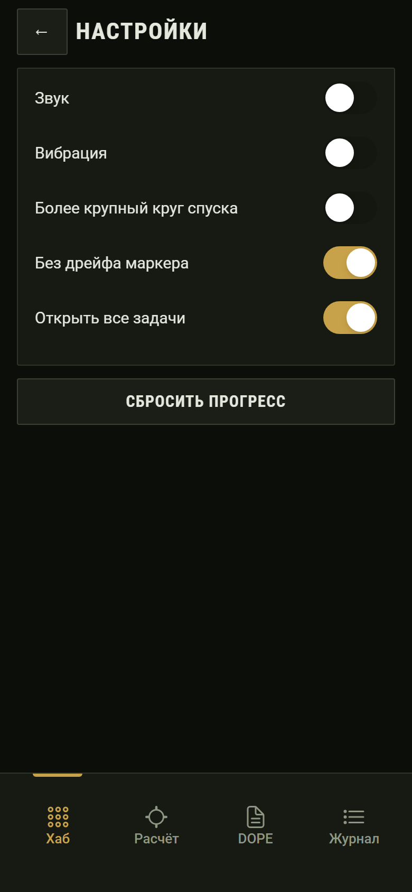

Тема (два чипа A/B), переключатели: Звук, Вибрация, Более крупный круг спуска, Без дрейфа маркера, Открыть все задачи; «Сбросить прогресс». Стандартные переключатели Ionic. **Макета нет.**

## Звук и вибрация

Звук — синтез Web Audio (заглушка до записей), вибрация — системная (на телефоне).

| Событие | Вибрация | Звук |
| --- | --- | --- |
| Клик барабана | лёгкий тик | сухой щелчок |
| Целый MIL / оборот | средний / двойной | громче |
| Упор, ZERO STOP | сильный | глухой стук |
| «Снять показания» | средний | писк |
| Выстрел | сильный | хлопок; удар по стали через время полёта + путь звука (≈3 с на 700 м) |
| Затвор: отпирание · назад · гильза · досылание · запирание | лёгкий · лёгкий · дрожь · средний · сильный | разные щелчки |
| Пустой ствол | предупреждение | — |

## Известные визуальные дефекты

Уйдут в стабилизацию; при макете — уточнить.

1. Панель вкладок 113 pt вместо 84: под подписями пустое место.
2. «Часы» ветра: «ЦЕЛЬ ↑» наезжает на цифру 12.
3. DOPE: на 100 м показывается «-0.0».
4. HUD: чипы ветра берут ±0,5 от замера (получается 0 / 0.2 / 0.7) — неровные значения.
5. Прицел: верхняя строка `↑ 0.0 · → 0.0` и `500 м · FFP · MIL` переносится на 390 pt.
6. Метеостанция: заголовок переносится («AB-совм.» на второй строке).
7. Разбор: точка промаха за пределами мишени прижимается к краю картинки; шапка шторки накрывает верхний барабан.
8. Затвор: рукоять (стебель) не видна в исходном положении — только шарик.
9. «Последний выстрел» и журнал пишут промах в MIL даже для прицела MOA.

## Что нужно от дизайна

1. **Прицел целиком в одном макете:** как в один экран входят стекло, барабаны со шкалой, полоса расчёта, кнопки и — по очереди — площадка спуска, панель затвора, итог задачи (сейчас три панели сменяют друг друга внизу).
2. **Площадка спуска внутри прицела:** размер, где «ДЫХ», нужны ли ЭКГ и крупный пульс.
3. **Панель затвора внутри прицела:** масштаб винтовки, где магазин и «Новый магазин».
4. **Экраны без макета:** журнал, викторина, настройки, раскрытый список задач, итог задачи.
5. **Закрытая строка ЖК** (Lv1–2) и вид «— стд.».
6. **Флажки на трассе** в сцене прицела (Lv3+): вид, размер.
7. **Направление ветра на HUD:** `→ 0.8 L` читается как «вправо»; предложение — `← 0.8 L` / `→ 0.8 R`.
8. **Иконки вкладок** и иконка приложения.
9. **Токены:** `radius-card` 16 вместо 12; цвета приборов (ЖК, циферблаты, бумага DOPE) — в токены.
10. **Реальные названия в превью** (`6.5 CM`, `IPSC`) заменить на вымышленные.
11. **Сцена для этапа 3:** уровень реализма (Pixi, фото-слои); список ассетов — в техническом документе.
